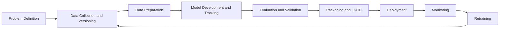

# House Price Prediction - MLOps Project

## 4. MLOps Lifecycle



### 4.1 Problem Definition
Define the business goal, the success metric (e.g. RMSE below 20,000) and constraints such as latency and budget.

### 4.2 Data Collection and Versioning
Gather data from CSV files, databases or APIs and version it so experiments are reproducible. Tools: DVC, Git LFS.

### 4.3 Data Preparation and Feature Engineering
Clean the data, handle missing values, encode categorical variables and scale features. Tools: Pandas, scikit-learn pipelines.

### 4.4 Model Development and Experiment Tracking
Train candidate models, tune hyperparameters and log parameters, metrics and artifacts for every run. Tools: MLflow, Weights and Biases.

### 4.5 Model Evaluation and Validation
Evaluate on a held-out test set using RMSE, MAE and R2. Compare against a baseline and check for bias before approving a model.

### 4.6 Packaging and CI/CD
Package the model and its dependencies in a Docker container. Run automated tests and builds on every pull request. Tools: Docker, GitHub Actions.

### 4.7 Deployment
Serve the model as a REST API, deployed to cloud or Kubernetes. Tools: FastAPI, Flask, Kubernetes.

### 4.8 Monitoring
Track latency, error rates, data drift and prediction quality in production. Tools: Prometheus, Grafana, Evidently AI.

### 4.9 Retraining and Feedback Loop
When drift or performance degradation is detected, trigger retraining and return to stage 4.2. This makes the lifecycle a continuous loop.

## 5. Tools Summary
| Stage | Tool |
|---|---|
| Version control | Git, GitHub |
| Data versioning | DVC |
| Experiment tracking | MLflow |
| CI/CD | GitHub Actions |
| Containerization | Docker |
| Serving | FastAPI |
| Monitoring | Evidently, Grafana |

## 6. Getting Started
```bash
git clone https://github.com/RohanDivekar07/mlops-house-price.git
cd mlops-house-price
pip install -r requirements.txt
python src/train.py
```

## 7. Author
Rohan Divekar | ADT24SOCBD213 | MLOPS / MLOPS
